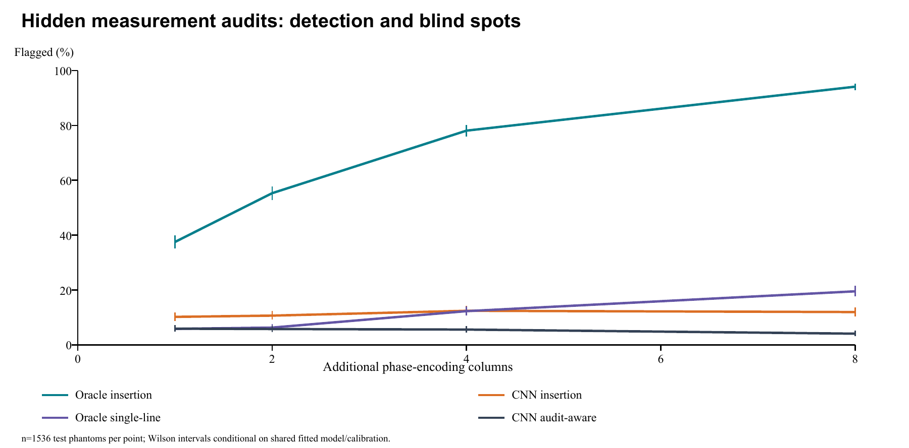
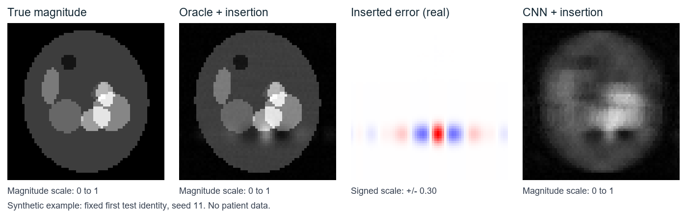

# K-Sentinel

[](https://github.com/vinsymoyya/k-sentinel/actions/workflows/ci.yml)

**Can an AI reconstruction match its acquired MRI measurements and still contain an unsupported structure? Yes. Can a small independent audit always catch it? No.**

An open, CPU-reproducible benchmark of measurement-blind errors, hidden Fourier audits, and their limits. Includes synthetic data, a small trained CNN, an external reconstruction interface, complete results, and an unreviewed methods preprint.

[Read the paper](output/pdf/k-sentinel-preprint.pdf) · [Market and opportunity analysis](research/MARKET_ANALYSIS.md) · [Protocol](RESEARCH_PROTOCOL.md) · [Full results](results/main/summary.json) · [Contribute](CONTRIBUTING.md)



## What the experiment found

Three seeds, **1,536 independent test phantoms**, three reconstruction controls, seven challenge categories and four audit budgets. The resulting **129,024 records are repeated evaluations of those test phantoms**, not separate patients.

At **four additional Cartesian columns**, selected from 48 initially unacquired columns:

| Reconstruction | Controlled insertion flagged | Clean reconstruction flagged |
|---|---:|---:|
| Small CNN | 191/1,536 (12.4%) | 86/1,536 (5.6%) |
| Zero filling | 124/1,536 (8.1%) | 77/1,536 (5.0%) |
| Oracle control, requiring true anatomy | 1,199/1,536 (78.1%) | 70/1,536 (4.6%) |

The oracle is **not deployable**. Its result must not be presented as the trained model's result. Audit-aware errors evade the measurement test and receive the same decisions as their clean counterparts. Native CNN error substantially weakens sensitivity to additional controlled error. Fusing the same audit measurements for every CNN case outperformed the tested selective fusion rule. These limitations are part of the result.

The four-column audit raises sampling from 16/64 to 20/64 columns: a **25% increase over the initial sample count**. This is not a measured scan-time result. All thresholds, intervals, per-seed rates and policy errors are in the paper and machine-readable results.

## Try it on a CPU

Python 3.10 or newer. No credentials, patient data, GPU or external dataset required.

```bash
git clone https://github.com/vinsymoyya/k-sentinel.git
cd k-sentinel
python -m venv .venv
# Linux/macOS: source .venv/bin/activate
# Windows PowerShell: .\.venv\Scripts\Activate.ps1
python -m pip install -e .
python -m unittest discover -s tests -v
python -m ksentinel.benchmark --no-cnn --seeds 7 --train 16 --calibration 32 --test 16 --epochs 1 --output results/smoke
```

The quickstart is a **small smoke run**, not the published experiment. `--no-cnn` runs the two mathematical controls; its training identity range is reserved but no model is trained. Each result directory contains calibration scores, split identities, a synthetic example, full compressed subject records and a summary.

To repeat the published experiment, including training three CNNs:

```bash
python -m pip install -e ".[learned]"
python -m ksentinel.benchmark --output results/reproduce
python scripts/verify_checkpoints.py --directory results/reproduce
```

The recorded local run used Python 3.12.14, NumPy 2.5.4 and PyTorch 2.14.1+cpu; it completed in 173.1 seconds with two CPU training threads. That timing is environment-specific. Other supported Python/library combinations should reproduce the mechanism; floating-point values and trained weights can vary. Exact environment and experiment source hashes are in `results/main/config.json`. The broader dependency ranges support portability rather than claiming bitwise reproduction everywhere.

To check the saved publication record independently:

```bash
python scripts/verify_results.py
```

## Audit your own reconstruction

The public interface needs **no reference anatomy**. It compares a complex image against independently held-out complex Fourier values and calibration scores from matching clean cases.

```python
from ksentinel.audit import audit_reconstruction

result = audit_reconstruction(
    candidate=complex_image,          # shape (height, width), complex
    columns=audit_columns,            # unique integer phase-encoding columns
    audit_values=held_out_values,     # shape (height, number_of_columns)
    calibration_scores=clean_scores, # independent, matching reconstruction and budget
    sigma=0.02,                      # RMS complex noise in matching normalization
    alpha=0.05,
)
print(result["flagged"], result["p_value"])
```

Use the centered, unitary Fourier convention implemented in `ksentinel.core.fft`. The candidate must have been frozen before viewing audit data; the operator, intensity scale, budget, population and noise setting must match calibration. A negative flag is **not a certificate of correct anatomy**. Correlated coils, arbitrary DICOM images, motion, non-Cartesian sampling and unknown sensitivity maps require a different validated operator. Calibration controls baseline rejection under exchangeability, not sensitivity to disease or new error.

The CLI accepts an NPZ with `candidate`, `columns`, `audit_values`, `calibration_scores`, and scalar `sigma`:

```bash
python -m ksentinel.audit your_audit.npz
```

## What is released

| Item | Location |
|---|---|
| Unreviewed 8-page methods preprint | [PDF](output/pdf/k-sentinel-preprint.pdf), [Markdown](paper/manuscript.md) |
| 5-page market analysis | [PDF](output/pdf/medical-imaging-ai-market-analysis.pdf), [Markdown](research/MARKET_ANALYSIS.md) |
| Fixed protocol and experimental design | [Protocol](RESEARCH_PROTOCOL.md) |
| Phantom, Fourier, noise and perturbation generator | [Core](ksentinel/core.py) |
| Downloadable 16-object synthetic test subset | [NPZ dataset](data/synthetic-demo.npz), [exporter](scripts/export_demo.py) |
| CNN definition and training | [Learned control](ksentinel/learned.py) |
| External reconstruction audit | [API and CLI](ksentinel/audit.py) |
| All 129,024 evaluation records | [Compressed CSV](results/main/subjects.csv.gz) |
| All 84 endpoint summaries and per-seed rates | [Summary](results/main/summary.json) |
| Checkpoints and calibration scores | [Results directory](results/main) |
| Split IDs and data description | [Splits](results/main/splits.json), [data card](DATA_CARD.md) |
| Independent numerical reaggregation | [Verification](results/main/verification.json) |
| Sources and live ecosystem snapshot | [Sources](research/sources.json), [GitHub snapshot](research/github_landscape.json) |



The example is the first test object from seed 11, selected by a fixed rule. It is synthetic; projected templates are not biological lesions. Magnitude panels share a 0-1 display scale; signed injected error has a separate scale.

## Scope, prior art and research direction

This release is a synthetic methods benchmark, not a diagnostic system or a demonstrated reduction in invasive procedures. It does not measure natural hallucination prevalence or real pathology detection. The small CNN is an inexpensive control, not a state-of-the-art reconstruction system.

Null-space hallucinations, self-supervised measurement splitting and uncertainty-aware adaptive MRI already have substantial prior art. Read [Bhadra et al.](https://doi.org/10.1109/TMI.2021.3077857), [SSDU](https://doi.org/10.1002/mrm.28378), [CUTE-MRI](https://arxiv.org/abs/2508.14952), and [QUTCC](https://arxiv.org/abs/2507.14760v2). K-Sentinel packages an explicit failure suite, calibration, equal-budget comparison and reference-free input contract. It does not claim to invent their underlying ideas or outperform their systems.

The next substantive step is subject-disjoint multicoil raw-data evaluation with real pathology, a competitive reconstruction baseline, frozen audit policy and measured acquisition overhead. See the [roadmap](ROADMAP.md). The separate photoacoustic project is not modified or incorporated into this study.

## Reuse, citation and community

**Author:** [Vinsy Moyya](https://orcid.org/0009-0003-0042-3556). Code and documentation: [MIT](LICENSE). Generated synthetic data and numerical results: CC0-1.0; details in the data card. Third-party data retain their own terms. There is no patient-data redistribution in this repository.

Use [CITATION.cff](CITATION.cff) or [paper/citation.bib](paper/citation.bib). No DOI or peer-review acceptance is asserted. ORCID attribution is documented in [publication guidance](PUBLICATION.md).

Useful contributions include independent reproductions, a tested external reconstruction adapter, measurement-operator tests and counterexamples where the audit fails. A star helps others find the benchmark; a fork is most useful when it produces a reproducible experiment. See [contribution guidance](CONTRIBUTING.md).
