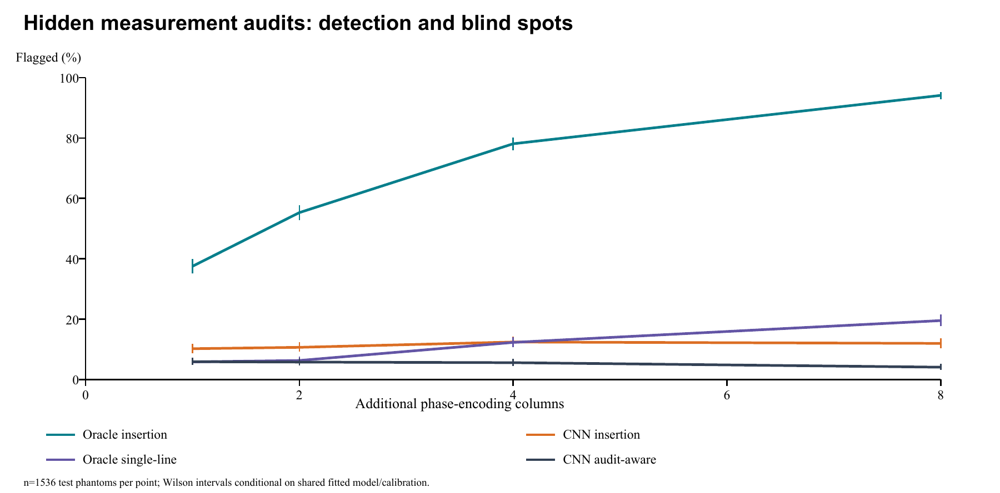
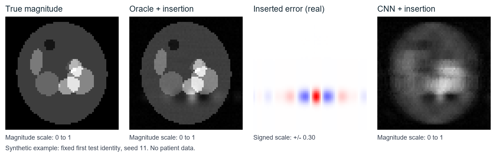

# K-Sentinel: A Reproducible Benchmark of the Limits of Held-Out Measurement Audits for AI MRI Reconstruction

**Vinsy Moyya**

ORCID: [0009-0003-0042-3556](https://orcid.org/0009-0003-0042-3556)

**Unreviewed synthetic methods preprint | Version 0.1.0 | 3 November 2026**

## Abstract

**Purpose.** Test whether a small independent Fourier measurement audit can expose controlled reconstruction changes that acquired-data consistency cannot detect, and quantify its limitations when a learned reconstruction already has native error. **Methods.** We generated independent complex-valued 64 x 64 ellipse phantoms under a simplified single-coil Cartesian MRI model. Three seeds each used 512 training, 256 calibration and 512 test objects. Reconstruction controls were zero filling, a small supervised residual CNN followed by data projection, and a nondeployable oracle. We added 10% relative-L2 null-space errors, including a projected localized template, a concentrated Fourier-line error, and an audit-aware error. One, two, four or eight initially unacquired columns supplied audit measurements. Clean calibration scores set a 5% split-conformal rejection threshold per model and budget. **Results.** At four audit columns, controlled insertion was flagged in 191/1536 CNN cases (12.4%), versus 86/1536 clean cases (5.6%). The oracle flagged 1199/1536 insertions (78.1%) with 4.6% clean rejection. Audit-aware errors produced the same flag decisions as their clean counterparts. The CNN's mean native complex NRMSE was 0.1981; using all audit measurements for coefficient fusion improved insertion-case NRMSE to 0.2134, compared with 0.2196 for selective fusion. **Conclusion.** Independent measurements can reveal some measurement-blind errors, but sensitivity depends strongly on the reconstruction's native error and audit support. This released benchmark demonstrates a useful failure-testing workflow, not a clinical safety certificate, a new reconstruction method, or demonstrated scan-time reduction.

**Keywords:** accelerated MRI; inverse problems; hallucinations; calibration; reproducibility; noninvasive imaging.

## 1. Introduction

Medical imaging AI operates at several levels: reconstruction from sensor measurements, enhancement of existing images, anatomical segmentation, quantitative analysis and interpretation. A reconstruction error can propagate through every subsequent stage. For noninvasive imaging, improving acquisition efficiency is valuable only if information required by the clinical task is retained. Visual plausibility and a small residual on data used during reconstruction are incomplete evidence of anatomical fidelity.

The problem is well established. Antun et al. described reconstruction instabilities, including missed structures [1]. Bhadra et al. formulated measurement/null decompositions and hallucination maps [2]. SSDU uses disjoint data subsets for self-supervised MRI training [3]. CUTE-MRI studies calibrated task uncertainty and adaptive acquisition [4], while QUTCC provides calibrated image uncertainty [5]. A 2026 pathology-focused MRI uncertainty study further emphasizes evaluation near relevant structures [6]. Consequently, neither null-space blindness, holdout measurements nor uncertainty-aware acquisition is claimed as a new idea here.

The contribution is a compact, openly reproducible **stress benchmark**: it separates ordinary consistency from independent measurement support; includes a trained baseline as well as a deliberately privileged oracle; preserves fixed calibration/test partitions; reports acquisition overhead; and exposes an audit-aware evasion case. We also compare a selective fusion rule with the simpler policy of fusing the same measurements for everyone. The study asks what such a small audit can actually establish before extrapolating toward a clinical workflow.

## 2. Scope and contribution boundary

The intended immediate audience is researchers evaluating image reconstruction, not clinicians interpreting patient scans. All objects are synthetic. A projected Gaussian error is called insertion or removal according to its sign; it is not a biological lesion or a disease label. Detection below means rejection of a score relative to a clean calibration distribution, not cancer sensitivity. Clean means no added challenge, although a learned reconstruction can still contain substantial native error.

This is an exploratory computational methods report. Its protocol was recorded locally before the first run but was not externally preregistered. No clinical data, proprietary reconstruction system or real scanner was evaluated. The independent external-input interface is useful for future comparisons, but this release does not establish an advantage over current MRI reconstruction systems or the closest published uncertainty methods.

## 3. Imaging model and audit

### 3.1 Forward model

Let F be a centered unitary 2D discrete Fourier transform, x a complex image, and M a mask selecting complete phase-encoding columns. Initially acquired data are y_M = M F x + noise. Each real and imaginary noise component has standard deviation sigma/sqrt(2), so expected squared complex noise magnitude is sigma^2. The fixed sigma is 0.02 in normalized phantom-intensity units. No physical tissue unit is implied.

A candidate image is projected to the acquired data by replacing its selected Fourier coefficients with the measured coefficients. In exact arithmetic:

```
DC(z, y, M) = F^-1 [ M y + (I-M) F z ]
```

If M F delta = 0, adding delta leaves the initial measurements unchanged. This elementary nonidentifiability argument motivates the controlled challenges and follows the established null-space perspective [2]. Finite precision is reported rather than treated as exact zero.

### 3.2 Independent audit score

An audit selects b columns uniformly without replacement from the 48 columns not initially acquired. Budgets b = 1, 2, 4, 8 form prefixes of a hidden random order, allowing paired comparisons. The candidate reconstruction, CNN training and ordinary perturbation generator do not receive audit mask identities or audit values. The oracle uses the exact underlying image as an explicitly nondeployable control.

For an H-row image and audit mask A, define:

```
S(z) = sum_{j in A, r=1..H} |(Fz)[r,j] - y_A[r,j]|^2
       / (H * b * sigma^2)
```

Only candidate predictions and the independently acquired audit values are required. Ground-truth anatomy is used for simulation evaluation, not for the deployed-form score. Larger residuals indicate disagreement with the audit, but can arise from reconstruction bias, noise changes, motion or an incorrect operator as well as an invented structure.

### 3.3 Calibration and the limited guarantee

For each reconstruction model and audit budget, 256 independent clean calibration objects produce scores. With alpha = 0.05, the threshold is the 245th smallest calibration score because ceil((256+1)(1-alpha)) = 245. A test case is flagged only when its score strictly exceeds this threshold. An equivalent conservative rank p-value is (1 + number of calibration scores at least as large as the test score)/257. Ties are handled conservatively.

The standard exchangeable-rank argument bounds marginal rejection of a new clean example by alpha [7]. Conditional on a fixed independently trained model, the new clean score and calibration scores have exchangeable ranks if the object, noise and audit selection mechanisms match. This guarantee concerns the calibration-defined baseline population. It neither bounds image error nor guarantees rejection of a structured alternative. It also does not guarantee a 5% rate conditional on a particular realized calibration set, anatomical subgroup, or changed scanner/noise distribution.

### 3.4 Acquisition accounting

The initial mask contains 16 of 64 columns, including six central columns and ten randomly selected remaining columns. Four audit columns increase sampling from 25% to 31.25% of the grid, a 25% increase relative to the initial coefficient count. The nominal full-grid-to-sampled-column ratio changes from 4 to 3.2. These are line-count quantities, not measured acceleration or scan duration: sequence timing, gradient constraints and hardware overhead are omitted.

## 4. Experimental methods

### 4.1 Synthetic populations and split discipline

Each object contains an outer ellipse, seven random internal ellipses, clipped nonnegative magnitude normalized to unit maximum, and a smooth linear complex phase. Object identities determine independent procedural draws. Seeds 11, 29 and 47 each use disjoint ranges for 512 training, 256 calibration and 512 test identities. There are 3,840 base objects in total, including 1,536 held-out test objects. Reuse across methods, challenge categories and budgets is deliberate pairing, not additional independent subjects.

The anatomy-shift probe changes the same object's generation rule to twelve potentially smaller ellipses. The noise-shift probe doubles sigma to 0.04 while retaining thresholds and score normalization from calibration. Both are stress probes without a nominal coverage claim. They do not represent demographic subgroups, disease cohorts or external hospitals.

### 4.2 Reconstruction controls

Zero filling sets unacquired coefficients to zero. The CNN processes real/imaginary channels using four 3x3 convolutions with widths 2-16-16-16-2, three ReLU activations, and an image residual connection. It is trained for eight fixed epochs with Adam at 0.001, batch size 32 and channelwise squared-error loss. Each training object's acquisition and noise are fixed across epochs. The output is projected onto initial measurements. There is no validation-driven architecture tuning, early stopping, test selection, pretrained weight or external training image.

The oracle starts from true complex x and inserts only the measured coefficients at initial locations. It therefore has no unacquired reconstruction bias and reveals the audit's mechanism under privileged conditions. It cannot be used as an attainable reconstruction baseline. Model-specific calibration is necessary because natural reconstruction errors strongly change the score distribution.

### 4.3 Controlled alternatives

Projected Gaussian insertion/removal uses a random localized Gaussian template, zeros its initially acquired Fourier coefficients, inverse transforms, and scales its complex L2 norm to 0.10 times the truth norm. Projection makes it spatially oscillatory; biological lesion realism is not assumed. Both signs use the same paired template.

The single-line challenge puts all injected error energy in one uniformly selected unacquired Fourier column. A b-column random audit intersects that support with probability b/48. This is an exposure probability, not an unconditional detection guarantee. The audit-aware challenge selects a column outside both initial and largest audit masks; it explicitly violates the hidden-audit threat model and demonstrates the consequence of revealing the audit. All injected challenges have the same relative-L2 error norm.

### 4.4 Policies, endpoints and statistics

We report clean rejection, challenge rejection, ordinary empirical score AUROC against clean cases, complex-image normalized RMSE, and acquired-data residual. AUROC includes all case-versus-clean score pairs; subjects are paired across scenarios, so no independent-sample significance test is inferred from AUROC.

For each budget we compare unchanged candidate, coefficient fusion of the audit measurements for every case, and fusion only when the audit flags a case. Both fusion policies already acquired the same audit data. Therefore selective fusion cannot claim measurement savings in this experiment. A flag can alternatively motivate human review, but no review outcome is measured.

Wilson 95% intervals describe phantom-level rejection proportions. Per-seed rates are retained. Paired bootstrap intervals for selective-minus-universal-fusion NRMSE use 500 subject-level resamples with models and calibration held fixed. Pooled intervals omit shared calibration/training uncertainty and are not patient-population uncertainty estimates. The study contains many secondary comparisons and no multiplicity-adjusted superiority claim.

## 5. Results

### 5.1 Four-column audit

| Reconstruction | Clean | Insertion | Removal | Single-line | Audit-aware |
|---|---|---|---|---|---|
| oracle | 70/1536; 4.6% (3.6-5.7) | 1199/1536; 78.1% (75.9-80.1) | 1196/1536; 77.9% (75.7-79.9) | 189/1536; 12.3% (10.8-14.0) | 70/1536; 4.6% (3.6-5.7) |
| zero_fill | 77/1536; 5.0% (4.0-6.2) | 124/1536; 8.1% (6.8-9.5) | 120/1536; 7.8% (6.6-9.3) | 130/1536; 8.5% (7.2-10.0) | 77/1536; 5.0% (4.0-6.2) |
| cnn | 86/1536; 5.6% (4.6-6.9) | 191/1536; 12.4% (10.9-14.2) | 169/1536; 11.0% (9.5-12.7) | 189/1536; 12.3% (10.8-14.0) | 86/1536; 5.6% (4.6-6.9) |

**Table 1.** Flagged count and percentage at b=4; all groups have 1,536 test phantoms. Intervals are descriptive pooled Wilson intervals conditional on fitted calibration/model. The oracle is privileged and nondeployable. Native reconstruction error remains in clean CNN and zero-filled candidates.

The acquired residual remains near floating-point precision for the injected challenges, including cases with sizeable image error. For CNN insertions its maximum is 8.44e-08; the oracle maximum is 3.28e-16. This is a constructed demonstration of a consistency blind spot, not an estimate of how often natural neural hallucinations occur in patient imaging.

The gap between oracle and CNN performance is central. CNN insertion rejection is 12.4% rather than the oracle's 78.1%, and its insertion-versus-clean score AUROC is 0.559. Calibrating on native reconstruction error absorbs substantial score variability. The audit therefore has weak practical sensitivity to this controlled 10% relative-L2 challenge in the tested learned model.



**Figure 1.** Rejection across four budgets, with descriptive pooled Wilson intervals. Additional lines are counted in every arm. Increasing budget does not make the audit an anatomical certificate.

### 5.2 Concentration, audit knowledge and distribution shift

The oracle single-line rejection at four columns is 12.3%, while audit-aware rejection is 4.6% and has the same individual flag decisions as clean data. Any audit-aware score changes are numerical roundoff. The single-line result is consistent with support exposure being a limiting factor; the independent audit cannot recover information from columns it never samples.

With doubled noise, the oracle rejects 100.0% of cases, demonstrating sensitivity to departure from the calibrated noise setting rather than specificity to false structures. CNN noise-shift rejection is 7.1%. The anatomy-shift probe produces 3.0% CNN rejection; it does not establish robust external-site coverage. Complete rates and per-seed values for all 84 model/case/budget groups accompany the release.

### 5.3 Same-budget fusion comparison

| Reconstruction / case | Candidate | Fuse all | Selective fusion |
|---|---:|---:|---:|
| oracle / clean | 0.0296 | 0.0331 | 0.0298 |
| oracle / insertion | 0.1044 | 0.1013 | 0.1011 |
| zero_fill / clean | 0.2323 | 0.2229 | 0.2307 |
| zero_fill / insertion | 0.2534 | 0.2430 | 0.2507 |
| cnn / clean | 0.1981 | 0.1904 | 0.1970 |
| cnn / insertion | 0.2223 | 0.2134 | 0.2196 |

**Table 2.** Mean complex NRMSE at b=4. Both policies acquire the same columns. A lower error is better. Oracle fusion can introduce measurement noise in coefficients it already knew correctly, which is why oracle outcomes cannot justify a deployable policy.

For CNN insertions, universal fusion yields 0.2134 mean NRMSE versus 0.2196 with selective fusion. The mean selective-minus-universal difference is 0.0062, with a conditional subject-bootstrap interval of 0.0059 to 0.0065. This result supports using the acquired measurements directly for this baseline rather than claiming selective fusion is more efficient. The oracle is an instructive exception because it already knows unsampled coefficients and can lose precision by inserting noisy data.



**Figure 2.** First test identity from seed 11, chosen by a fixed rule: true magnitude, oracle candidate with projected insertion, real part of the inserted error, and CNN insertion candidate. Shared magnitude scaling is used for the three magnitude panels; the signed error uses a separate symmetric color scale. These are digital objects, not patient scans.

### 5.4 Reproducibility evidence

The full run completed on CPU in 177.7 seconds in the recorded environment. This is a local end-to-end simulation timing, not clinical inference latency or a cross-hardware benchmark. The release includes all 129,024 subject/model/case/budget rows, calibration scores, split identities, three small checkpoints, generator, source hashes and an independent aggregation checker. The checker recomputed all 84 group counts, means and Wilson intervals, checked split separation, mask disjointness, finite scores, rank thresholds, source hashes, and audit-aware/clean decision equality. Software tests separately exercise Fourier unitarity, null-space construction, the analytic audit input contract and noiseless fusion.

## 6. Discussion

The useful operational distinction is between consistency with reused measurements and disagreement with independent measurements. The first is often guaranteed by the reconstruction procedure. The second can provide additional evidence but is constrained by the sampled support and the reference population used to define unusual behavior. In particular, a calibrated clean rejection rate does not imply calibrated lesion detection.

The measured native-CNN sensitivity is too limited to justify clinical claims. It also shows why reporting only the oracle's substantially larger detection rate would be misleading. Better reconstruction, residual whitening, endpoint-specific scores or repeated audits could change performance, but would require new protocols, new held-out data and comparison with the closest existing methods. Test results from this release must not be used to silently tune a supposedly untouched benchmark.

The fair-fusion comparison identifies another practical constraint: once independent measurements have been acquired, their direct use may be more valuable than a selective flagging rule. Our experiment does not establish a faster scan or avoided acquisition. A future policy would need prospective decisions about whether to obtain further data, explicit sequence timing, model selection that never sees the hidden audit, and a same-budget comparator.

This benchmark complements the prior work in [2-6] by making several limitations easy to reproduce together. It is not a systematic superiority evaluation against those papers. It may be useful as a teaching example, an adapter test, and a falsification tool for overly broad safety claims. Its scientific contribution is presently an engineering and empirical reproducibility contribution, not a new theorem or evidence of a clinical breakthrough.

## 7. Limitations and next experiments

The largest limitation is synthetic external validity: ellipses do not capture real anatomy, disease, acquisition artifacts or the clinical salience of a small structure. The single-coil Cartesian operator excludes coil sensitivity estimation, noise correlation, motion, relaxation and trajectory errors. Exact-operator simulation favors a measurement audit whose own physics can be wrong in deployment.

The small CNN and fixed eight-epoch regime are intentionally inexpensive rather than competitive. The 10% norm setting is only one perturbation scale. We do not estimate the natural prevalence of reconstruction failures, disease sensitivity, specificity against real lesions, subgroup fairness, or clinical decision impact. The test subjects are reused across challenges and budgets. Three seeds and conditional intervals cannot characterize the full uncertainty of model training or calibration. Single-line and audit-aware controls are not anatomically realistic.

The next evidence-producing study should freeze one competitive multicoil reconstruction baseline, obtain appropriately licensed raw data with pathology annotations, split at subject/site level, and evaluate natural as well as controlled errors. It should compare random audits with task-directed acquisition and same-budget fusion, and assess endpoint changes with clinician-defined relevance. A prospective scanner study would then measure real overhead and failure handling. None of these results is supplied by this release.

## 8. Conclusion

K-Sentinel releases a small, fully inspectable experiment showing both the appeal and the limits of independent measurement audits. A consistency-preserving error can be invisible to initial measurements, partly exposed by additional measurements, or remain invisible when its support avoids the audit. In the trained synthetic CNN, the tested audit detects only a modest fraction of controlled insertions. The appropriate immediate output is an open methods benchmark and unreviewed preprint, with real-data and clinical validation explicitly outstanding.

## 9. Data, code and author information

Code and documentation: MIT. Synthetic data and numerical result files: CC0-1.0. No patient data or third-party trained weights are redistributed. Code, protocol, checkpoints and results: [github.com/vinsymoyya/k-sentinel](https://github.com/vinsymoyya/k-sentinel). The repository is the source of the versioned experimental record. No DOI is asserted for this preprint unless a deposit is separately completed and verified.

Author: Vinsy Moyya; ORCID 0009-0003-0042-3556, supplied by the author. No institutional affiliation is asserted. The work uses only procedurally generated data, with no patient participation. An institutional ethics determination was not sought for this synthetic software study; clinical studies would require their own approvals. Funding and competing-interest statements require the author's completion for any journal submission and are not inferred from account metadata. This manuscript has not undergone peer review.

## References

[1] Antun V, Renna F, Poon C, Adcock B, Hansen AC. On instabilities of deep learning in image reconstruction and the potential costs of AI. PNAS, 2020. [doi:10.1073/pnas.1907377117](https://doi.org/10.1073/pnas.1907377117).

[2] Bhadra S, Kelkar VA, Brooks FJ, Anastasio MA. On Hallucinations in Tomographic Image Reconstruction. IEEE Transactions on Medical Imaging 40(11):3249-3260, 2021. [doi:10.1109/TMI.2021.3077857](https://doi.org/10.1109/TMI.2021.3077857).

[3] Yaman B et al. Self-supervised learning of physics-guided reconstruction neural networks without fully sampled reference data. Magnetic Resonance in Medicine, 2020. [doi:10.1002/mrm.28378](https://doi.org/10.1002/mrm.28378).

[4] Fischer P, Morshuis JN, Kuestner T, Baumgartner C. CUTE-MRI: Conformalized Uncertainty-based framework for Time-adaptivE MRI. arXiv preprint, 2025. [arXiv:2508.14952](https://arxiv.org/abs/2508.14952).

[5] Ye CT, Li S, King T, Monakhova K. QUTCC: Quantile Uncertainty Training and Conformal Calibration for Imaging Inverse Problems. arXiv preprint, 2025; version 2, 2026. [arXiv:2507.14760v2](https://arxiv.org/abs/2507.14760v2).

[6] Saksena V, Knoll F, Kainz B. Uncertainty Estimation in Deep Learning MRI Reconstruction with Focus on Pathologies. MICCAI UNSURE workshop, 2026. [Official proceedings](https://papers.miccai.org/miccai-2026-sat/UNSURE2026_019.html).

[7] Angelopoulos AN, Bates S. A Gentle Introduction to Conformal Prediction and Distribution-Free Uncertainty Quantification. arXiv preprint, 2021. [arXiv:2107.07511](https://arxiv.org/abs/2107.07511).
