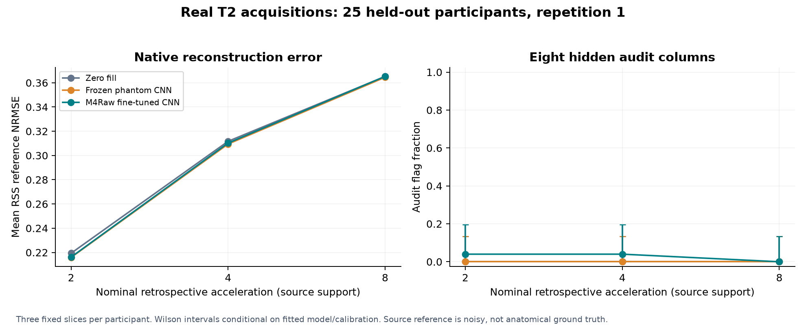
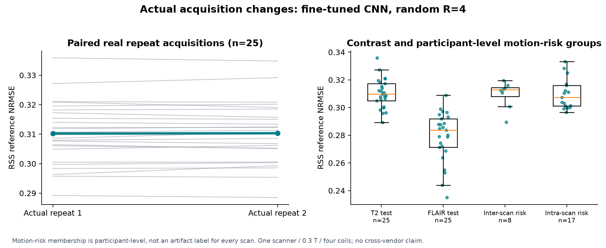
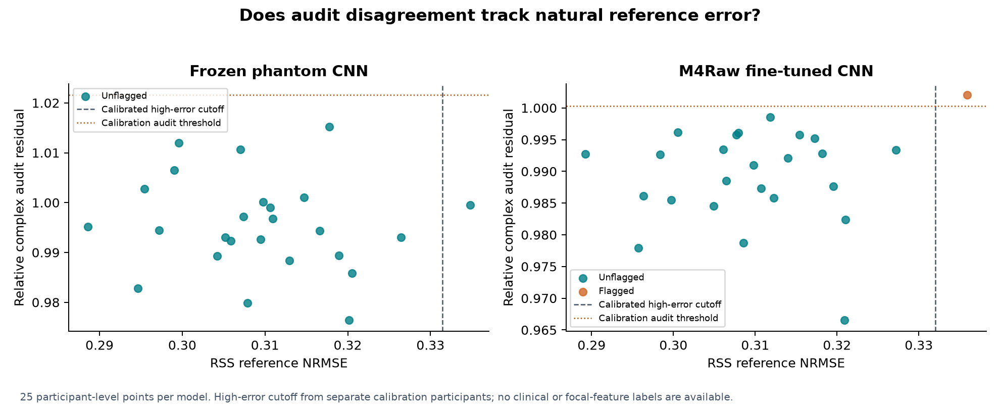
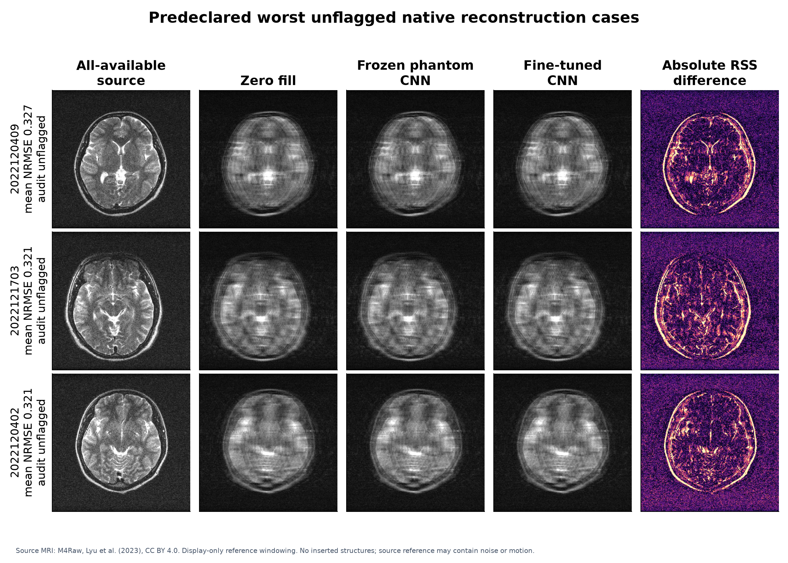
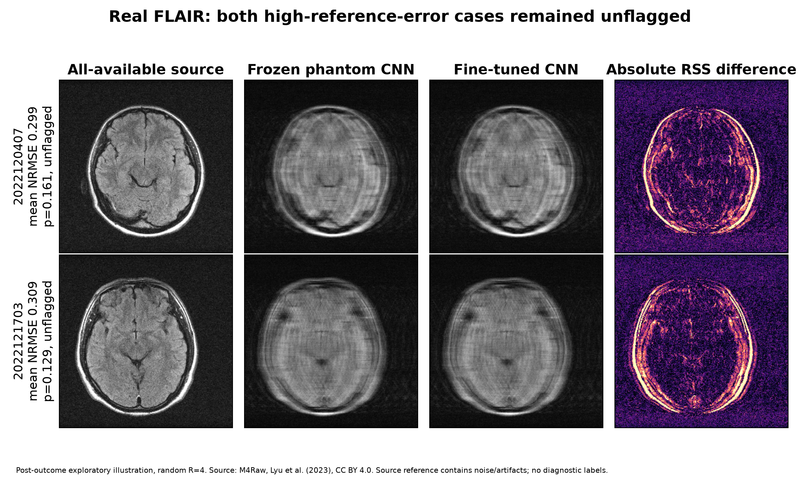

# Real acquisition variations and natural reference-error failures

## An exploratory K-Sentinel methods addendum

Vinsy Moyya | ORCID: https://orcid.org/0009-0003-0042-3556 | 2026-11-05 | Unreviewed research

## Main result

The complete experiment used **180 real M4Raw acquisitions from 100 participant-disjoint volunteers**. In the predeclared primary condition (T2, repeat 1, random retrospective R=4, fine-tuned CNN), mean RSS reference NRMSE was **0.3102**. The audit flagged **1/25** participants. **1** exceeded the calibration-defined high-reference-error cutoff; **0** of those remained unflagged.

Fine-tuning did **not** improve mean primary reference error over the frozen CNN: 0.31023 versus 0.30943. This study supplies real-acquisition evidence and failure analysis, not a demonstrated model-performance advance.

In the preplanned FLAIR/random/R=4 secondary condition, **2/2** high-reference-error cases remained unflagged among 25 test participants, despite contrast-matched calibration. This is direct real-acquisition evidence of a limitation, with small event counts and no diagnostic labels.

These endpoints concern agreement with the same acquisition's all-available, noisy source reconstruction. They do not establish anatomical correctness, detection of unsupported focal features, motion correction, diagnosis or patient benefit. Every deliberately injected image-structure challenge from the earlier synthetic study is absent here.

## Why this extension was needed

Community feedback asked whether measurement audits would remain useful under real acquisition variation and naturally occurring reconstruction failures. The original v0.1.0 paper and v0.2.0 synthetic results are preserved. This extension evaluates actual scanner-exported, source-corrected four-coil MRI measurements, rather than treating a Fourier transform of a magnitude image as raw acquisition data.

## Data, selection and licensing

M4Raw was acquired from healthy volunteers on one 0.3-T scanner with a four-channel head coil. We pinned the original creators' byte-preserving Hugging Face mirror to revision `46cb84455c0d6653b3b4afe27d56b10fbd4cd424`. The selected 180 H5 files total 2,221,536,429 bytes; every download was checked against its source SHA256 and size.

| Role | Distinct participants | Acquisitions used | Use |
|---|---:|---:|---|
| Training | 20 | 20 | T2 repeat 1, fixed fine-tuning |
| Calibration | 30 | 60 | T2 and FLAIR repeat 1, threshold fitting only |
| Expanded test | 25 | 75 | T2 repeats 1/2 and FLAIR repeat 1 |
| Motion-risk stress | 25 | 25 | T2 repeat 1; 8 inter-scan / 17 intra-scan participants |

The three fixed stored slices 7/8/9 are averaged to one acquisition-level score and error. All repeats stay in the same participant role. **2,880 result rows and repeated slices are not 2,880 independent people.** Motion-risk assignment is participant-level: an individual H5 is not thereby proven visibly corrupted. The data contain no disease or focal-lesion truth labels.

M4Raw data, derived selection metadata and source-based figures are CC BY 4.0, attributed to Lyu et al. Code and original analysis prose are MIT. The older CC0 synthetic dataset has a separate license. Public raw H5 payloads are downloaded from the creators, not relabeled as K-Sentinel synthetic data.

## Reconstruction and acquisition design

We compare zero filling, the immutable released phantom CNN seed 11, and that same architecture fine-tuned on twenty separate T2 training participants. Fine-tuning uses eight fixed epochs, Adam learning rate 0.0001, batch size 8 and seed 20261105. There are 240 training coil-slices, but only twenty training people. No calibration or test data update weights or select a checkpoint. The compact per-coil CNN does not exploit joint coil-sensitivity encoding and is not a state-of-the-art reconstruction comparator.

Native complex 256 x 256 arrays and all four coils are retained. Centered orthonormal FFT/IFFT is reconciled against the source RSS images. T2 has 195 acquired PE columns and FLAIR 198; the other stored columns are unavailable zero padding. Retrospective masks and audit samples are drawn only from actual source support.

Six retrospective settings combine nominal R=2/4/8 with random or approximately equispaced sampling. Sixteen initially acquired central ACS columns determine per-coil normalization. Reference images and hidden audit samples do not determine normalization or CNN input. Eight other acquired source columns are reserved for the independent audit. Initial measurements are projected back into every candidate exactly.

For primary T2 R=4, initial sampling retains 49/195 available columns; auditing raises this to 57/195. Eight columns are a 16.3% increase over the initial retained count. This is retrospective sample accounting, not measured scanner time or a prospective sequence experiment.

Actual variations are repeated scans, T2 versus FLAIR acquisitions, and participant-level motion-risk cohorts. Random/equispaced masks and R changes are retrospective simulations. No synthetic motion, added noise or artificial image structure is used in the present experiment.

## Calibration and reference-error definitions

The audit averages, over three slices, squared complex residual on hidden columns divided by their observed signal energy. It is not a whitened noise-likelihood statistic. Thirty separate calibration participants fit a threshold for each contrast/model/sampling condition. Rank p-values count conservative ties; scores are rounded to twelve decimal places to suppress numerical discrimination in the analytically constant zero-fill control. With thirty participants the minimum p-value is 1/31, and alpha=0.05 flags only scores above the largest calibration score, apart from conservative numerical ties.

High reference error uses the calibration 90th-percentile order statistic; for the primary fine-tuned condition the RSS NRMSE cutoff is **0.33201**. This is a benchmark error class, not a clinical failure or disease label. AUROC is reported only when both reference-error classes exist. No nominal coverage guarantee is asserted under cohort/acquisition shift.

## Primary results: 25 independent held-out participants

| Method | Mean RSS NRMSE | Audit flags | High-error cases | High-error unflagged | Reference-error AUROC |
|---|---:|---:|---:|---:|---:|
| Fine-tuned CNN | 0.31023 | 1/25 | 1 | 0 | 1.000 |
| Frozen phantom CNN | 0.30943 | 0/25 | 1 | 1 | 0.708 |
| Zero fill | 0.31171 | 0/25 | 1 | 1 | 0.500 |

Only **1** primary fine-tuned case exceeded the reference-error cutoff. This is too few events to estimate detection sensitivity reliably or interpret an AUROC as established generalization. An observed caught fraction must not be advertised as clinical sensitivity.

Fine-tuned minus zero fill paired RSS NRMSE difference: **-0.00148 [-0.00166, -0.00131]**, mean [95% participant-bootstrap interval]. Negative differences favor the fine-tuned model. These intervals condition on the fitted model and do not capture training/calibration-set uncertainty.

Fine-tuned minus frozen phantom cnn paired RSS NRMSE difference: **0.00080 [0.00070, 0.00091]**, mean [95% participant-bootstrap interval]. Negative differences favor the fine-tuned model. These intervals condition on the fitted model and do not capture training/calibration-set uncertainty.

## Acquisition changes and motion-risk stress

| Actual acquisition / cohort | Participants | Mean RSS NRMSE | Matched flags | Frozen T2/R4 flags | High-error cases | High-error unflagged |
|---|---:|---:|---:|---:|---:|---:|
| T2 inter_scan risk | 8 | 0.30944 | 0/8 | 0/8 | 0 | 0 |
| T2 intra_scan risk | 17 | 0.30970 | 0/17 | 0/17 | 1 | 1 |
| FLAIR repeat 1 | 25 | 0.27899 | 0/25 | 0/25 | 2 | 2 |
| T2 repeat 1 | 25 | 0.31023 | 1/25 | 1/25 | 1 | 0 |
| T2 repeat 2 | 25 | 0.31032 | 1/25 | 1/25 | 1 | 0 |

Actual T2 repeat 2 minus repeat 1 paired mean RSS NRMSE change: **0.00009 [-0.00034, 0.00054]**, 95% participant-bootstrap interval, n=25 paired people. No repeat was selected as a cleaner anatomical truth.

The frozen-threshold column is an additional exploratory analysis, specified after the main protocol during implementation and before inspecting held-out summaries. It reuses the exact T2/random/R4 calibration scores across changes, without recalibration or model updates. It does not change primary outcomes. Condition-matched and transferred thresholds answer different questions; neither supplies clinical validation.

## Native sampling failures and same-budget fusion

| Pattern | Nominal R | Zero-fill RSS NRMSE | Frozen CNN RSS NRMSE | Fine-tuned RSS NRMSE | Fine-tuned flags |
|---|---:|---:|---:|---:|---:|
| random | 2 | 0.21937 | 0.21588 | 0.21618 | 1/25 |
| random | 4 | 0.31171 | 0.30943 | 0.31023 | 1/25 |
| random | 8 | 0.36521 | 0.36451 | 0.36521 | 0/25 |
| equispaced | 2 | 0.21514 | 0.21153 | 0.21174 | 0/25 |
| equispaced | 4 | 0.30697 | 0.30418 | 0.30500 | 1/25 |
| equispaced | 8 | 0.36726 | 0.36651 | 0.36725 | 0/25 |

Primary all-subject audit fusion minus no fusion: mean RSS NRMSE difference **-0.01649 [-0.01808, -0.01502]**. Selective minus all-subject fusion: **0.01566 [0.01355, 0.01765]**. Both policies receive the same eight audit columns. The source reference includes those same measurements, so improved agreement is not independent evidence of anatomical or clinical improvement.

## Largest unflagged reference errors

| Public scan ID | Mean RSS NRMSE | Mean audit score | Rank p-value | High-reference-error class |
|---|---:|---:|---:|---|
| 2022120409 | 0.32719 | 0.99340 | 0.38710 | no |
| 2022121703 | 0.32104 | 0.98238 | 0.80645 | no |
| 2022120402 | 0.32092 | 0.96656 | 0.93548 | no |
| 2022101301 | 0.31956 | 0.98762 | 0.70968 | no |
| 2022120407 | 0.31821 | 0.99282 | 0.38710 | no |

Cases are selected by the fixed rule highest mean reference error among unflagged primary cases, with scan-ID tie breaking. The figure shows stored slice 8; ranking averages slices 7/8/9. No model or threshold was tuned on these cases. Pixel differences alone do not prove an unsupported lesion or a missed clinical finding.

### Additional contrast-failure illustration (post-outcome exploratory)

We also display all two high-reference-error, unflagged cases in the preplanned FLAIR/repetition-1/random-R=4 secondary stratum. This illustrative selection was made after outcome inspection and is not the predeclared primary-case panel. Both cases, rather than a visually selected subset, are included. The original primary results remain unchanged.

| Public scan ID | FLAIR RSS NRMSE | Audit p-value | Decision |
|---|---:|---:|---|
| 2022120407 | 0.29901 | 0.16129 | unflagged |
| 2022121703 | 0.30899 | 0.12903 | unflagged |

## Reproducibility and verification

The complete record contains **2880** acquisition/condition/model rows, **36** calibration strata and **90** reported test/stress groups. Every saved mask, per-slice mean, flag, high-error label and group summary is reconciled independently. Maximum acquired relative residual is **1.83e-07**; maximum stored-source RSS reconciliation error among 160 evaluation/calibration acquisitions is **8.93e-08**.

The completed cloud run used Python 3.13.18, NumPy 2.1.3 and PyTorch 2.11.0+cpu. The original 45 scientific/software contracts plus 12 new real-acquisition contracts pass without skips on GitHub and in Kaggle. Downloaded JSON/JUnit evidence, all result rows, fixed protocol/manifest, source hashes and the fine-tuned checkpoint accompany the release. The original synthetic results remain byte-preserved.

Reproduce with `scripts/download_m4raw.py`, then `scripts/run_real_acquisition.py` in a fresh output directory. Independently reconcile with `scripts/verify_real_results.py`. The public Kaggle notebook is https://www.kaggle.com/code/vinsymoyya/k-sentinel-real-mri-variations-and-failures .

## Limits and next validation

This is a single-scanner, four-coil, low-field healthy-volunteer pilot, with twenty fine-tuning people and twenty-five primary test people. Three fixed slices do not characterize an entire volume. Source references contain noise, partial PE support and possible motion. The per-coil CNN is a compact baseline; modern sensitivity-aware/unrolled reconstruction systems require separate comparisons. Thirty calibration people yield coarse tail ranks; repeated subjects are not new independent evidence. Bootstrap intervals condition on fitted models and calibration. Secondary comparisons are exploratory and do not support multiplicity-corrected superiority claims.

Actual contrast/repeat/motion-risk variation has been studied; new vendors, field strengths, prospective sequences, measured scan time, pathology cohorts and clinician-reviewed unsupported-feature labels remain untested. Next steps are stronger open multicoil models, independent-site raw data, registered clinical endpoints and reader review of native failure cases. The present result supports open error analysis and reproducibility, not clinical deployment or a proven reduction in invasive procedures.

## Figures

Source-based figures: M4Raw, Lyu et al. (2023), CC BY 4.0. They retain their own attribution and are not licensed as the older CC0 synthetic data.

## References

Lyu M, Mei L, Huang S, et al. M4Raw: A multi-contrast, multi-repetition, multi-channel MRI k-space dataset for low-field MRI research. Scientific Data 10, 264 (2023). https://doi.org/10.1038/s41597-023-02181-4 .

M4Raw original data, version 1.6: https://doi.org/10.5281/zenodo.8056074 . Original-creators' source and data card: https://huggingface.co/datasets/mylyu/M4Raw_brain/tree/46cb84455c0d6653b3b4afe27d56b10fbd4cd424 . License: https://creativecommons.org/licenses/by/4.0/ .

K-Sentinel fixed protocol, manifest and attribution: research/real-acquisition/PROTOCOL.md, manifest.json, SOURCE_NOTICE.md. Additional transfer analysis: EXPLORATORY_ANALYSES.md. Original unreviewed synthetic paper: v0.1.0; synthetic validation/data/model release: v0.2.0. Neither is rewritten by this addendum.
